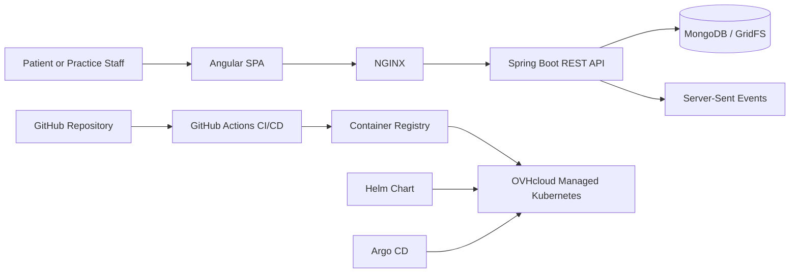

# PraxisForm

Digital patient intake platform for medical practices. The project combines a Spring Boot API, an Angular frontend, containerized local development, and Kubernetes deployment assets to demonstrate full-stack engineering, cloud delivery, and production-style DevOps practices in one repository.

## Project Overview

PraxisForm replaces paper intake forms with a structured digital workflow. Patients can submit their personal details, medical history, symptoms, attachments, and signature online, while practice staff review incoming submissions through an authenticated admin dashboard with live updates.

The project was developed as part of a hands-on Kubernetes and DevOps workshop and is presented here as a practical case study in application development and cloud-native delivery. It combines product functionality with the operational work needed to package, test, ship, and deploy a modern web application.

### Technical Highlights

- Full-stack development across backend, frontend, persistence, and authentication
- Containerization for consistent local and deployment environments
- Kubernetes application deployment using reusable Helm-based packaging
- Infrastructure as Code through manifests, chart values, and declarative deployment assets
- GitOps-oriented deployment using Argo CD application definitions
- Continuous Integration and Continuous Deployment with automated build, test, and image publishing workflows
- Cloud-native application delivery on managed Kubernetes infrastructure
- A production-style workflow from source control to container registry to cluster deployment

## Features

- Multi-step patient intake form with validation
- File upload support backed by MongoDB GridFS
- Digital signature capture in the browser
- JWT-based admin authentication
- Admin dashboard for reviewing and updating submissions
- Server-Sent Events for real-time submission updates
- Docker-based local development
- Kubernetes and ArgoCD deployment manifests

## Tech Stack

| Layer    | Technologies                                                                   |
| -------- | ------------------------------------------------------------------------------ |
| Backend  | Java 17, Spring Boot 4, Spring Security, Spring Data MongoDB, JJWT, Maven      |
| Frontend | Angular 21, TypeScript, Angular Material, RxJS, Nginx                          |
| Data     | MongoDB, GridFS                                                                |
| DevOps   | Docker, Docker Compose, Kubernetes, Helm, Argo CD, GitHub Actions, GHCR, NGINX |

## Architecture



The runtime architecture separates the user-facing SPA, backend API, and persistent document storage. The delivery architecture adds container builds, registry publishing, Kubernetes deployment, and GitOps-style reconciliation.

## Project Structure

```text
praxis/                      Spring Boot backend service
praxis-frontend/             Angular frontend application
kubernetes-manifest/my-chart/ Helm chart and Kubernetes deployment assets
argocd/                      Argo CD application definition
.github/workflows/           CI/CD automation
docker-compose.yml           Local full-stack environment
docker-compose.prod.yml      Production-oriented container deployment
```

Key repository areas:

- `praxis/`: backend service
- `praxis-frontend/`: frontend application
- `kubernetes-manifest/my-chart/`: Helm chart used by the GitHub Actions deploy job
- `argocd/app.yaml`: ArgoCD application definition
- `.github/workflows/`: CI/CD automation for test, build, packaging, and deployment
- `docker-compose.yml`: local full-stack environment

## Installation

### Prerequisites

- Docker and Docker Compose v2
- Java 17+ for backend-only local development
- Node.js 22+ for frontend-only local development

### Run With Docker

```bash
git clone <your-repository-url>
cd infra_x_projekt
docker compose up --build
```

Services:

- Frontend: http://localhost:4200
- Backend: http://localhost:8080
- MongoDB: mongodb://localhost:27017/praxis

### Run Locally Without Full Docker

Start MongoDB from the repository root:

```bash
docker compose up -d mongodb
```

Start the backend:

```bash
cd praxis
# Windows
mvnw.cmd spring-boot:run

# Linux/macOS
./mvnw spring-boot:run
```

Start the frontend in a second terminal:

```bash
cd praxis-frontend
npm install
npm start
```

## Usage

1. Open the patient-facing frontend at `http://localhost:4200`.
2. Submit a form with personal data, medical details, attachments, and signature.
3. Log in through the admin flow to review incoming submissions.
4. Track status changes and live updates in the admin dashboard.

## DevOps & Cloud

This repository is not only a web application; it also demonstrates how the application is packaged, delivered, and operated in a cloud-native environment.

| Technology                                | How it was used in this project                                                                                                                                                          |
| ----------------------------------------- | ---------------------------------------------------------------------------------------------------------------------------------------------------------------------------------------- |
| Docker and Docker Compose                 | The backend, frontend, and MongoDB services are containerized and can be started together locally through Docker Compose for reproducible development and integration testing.           |
| Kubernetes                                | The application was prepared for cluster deployment using Kubernetes resources for deployments, services, ingress, TLS-related assets, and secrets handling.                             |
| Helm Charts                               | The Kubernetes deployment is packaged as a Helm chart so image tags, replica counts, ingress settings, and environment values can be configured per environment.                         |
| Argo CD                                   | An Argo CD application definition is included to demonstrate pull-based synchronization of cluster state from Git-managed deployment configuration.                                      |
| GitOps workflow                           | Deployment configuration is expressed declaratively in version-controlled manifests and chart values, enabling auditable, repeatable changes rather than manual cluster edits.           |
| GitHub Actions / CI/CD                    | The workflow runs backend verification, frontend build steps, container image builds, and deployment automation from the repository pipeline.                                            |
| NGINX                                     | NGINX serves the Angular production build inside the frontend container and is also reflected in ingress-based routing for Kubernetes delivery.                                          |
| MongoDB                                   | MongoDB stores application data, while GridFS handles uploaded attachments from patient submissions.                                                                                     |
| Container Registry                        | CI publishes versioned backend and frontend container images to a registry so Kubernetes deployments consume immutable build artifacts instead of local images.                          |
| Kubernetes manifests                      | The repository includes raw deployment assets and templated chart files, showing both direct Kubernetes modeling and reusable packaging.                                                 |
| OVHcloud Managed Kubernetes (CaaS)        | The workshop deployment target was a managed Kubernetes environment, demonstrating how the application can be delivered on hosted cloud infrastructure rather than a local-only cluster. |
| Cloud deployment and application delivery | The overall flow covers code, build, packaging, image publishing, cluster rollout, and externally reachable delivery through ingress-based routing.                                      |

## Environment Variables

| Variable                 | Purpose                                   | Default                                    |
| ------------------------ | ----------------------------------------- | ------------------------------------------ |
| `MONGODB_URI`            | Backend MongoDB connection string         | `mongodb://localhost:27017/praxis`         |
| `JWT_SECRET`             | JWT signing secret used by the backend    | Set via environment for shared deployments |
| `JWT_EXP_MINUTES`        | Access token lifetime in minutes          | `120`                                      |
| `ADMIN_DEFAULT_PASSWORD` | Seeded admin password for first startup   | Set via environment for shared deployments |
| `API_URL`                | Frontend API base URL injected at runtime | `http://localhost:8080`                    |

For any public or shared deployment, provide `JWT_SECRET` and `ADMIN_DEFAULT_PASSWORD` through environment variables or secret management. Do not rely on development fallbacks.

## API Overview

### Public Endpoints

| Method | Endpoint           | Purpose                                     |
| ------ | ------------------ | ------------------------------------------- |
| `POST` | `/api/submissions` | Submit a new patient intake form            |
| `POST` | `/api/auth/login`  | Authenticate an admin user and return a JWT |

### Admin Endpoints

| Method  | Endpoint                                           | Purpose                                           |
| ------- | -------------------------------------------------- | ------------------------------------------------- |
| `GET`   | `/api/admin/submissions`                           | List submissions, optionally filtered by status   |
| `GET`   | `/api/admin/submissions/{id}`                      | Retrieve a single submission                      |
| `PATCH` | `/api/admin/submissions/{id}`                      | Update editable submission data                   |
| `PATCH` | `/api/admin/submissions/{id}/status`               | Move a submission through the status workflow     |
| `GET`   | `/api/admin/submissions/{id}/attachments/{fileId}` | Download an uploaded file                         |
| `GET`   | `/api/admin/submissions/stream`                    | Subscribe to real-time submission updates via SSE |

## Testing

Backend tests and coverage are part of the Maven workflow:

```bash
cd praxis

# Windows
mvnw.cmd verify

# Linux/macOS
./mvnw verify
```

Frontend validation is driven through the Angular toolchain:

```bash
cd praxis-frontend
npm install
npm run build
```

The repository also includes a frontend test script via `npm test`, while CI currently emphasizes backend verification, frontend build validation, artifact generation, and container packaging.

## Deployment

The repository demonstrates a production-style deployment workflow rather than a local-only setup:

- Docker Compose provides a fast full-stack local environment for development and verification.
- GitHub Actions runs CI tasks, builds container images, and publishes deployable artifacts.
- The Helm chart in `kubernetes-manifest/my-chart/` packages the Kubernetes deployment.
- Argo CD provides a GitOps-compatible application definition for cluster synchronization.
- Container images are pushed to a registry and then consumed by Kubernetes deployments.
- The deployment model aligns with managed Kubernetes delivery on OVHcloud CaaS.

Typical delivery flow:

1. Commit application or infrastructure changes to Git.
2. Run CI to validate the backend and frontend.
3. Build and publish container images.
4. Deploy through Helm-based Kubernetes configuration.
5. Reconcile the desired state in-cluster through Argo CD or pipeline-driven rollout.

## Future Improvements

- Consolidate overlapping deployment assets into one clearly documented primary Kubernetes path
- Add an OpenAPI or Postman artifact for easier backend evaluation
- Extend automated frontend test coverage beyond build validation
- Add environment example files and deployment profiles for smoother onboarding
