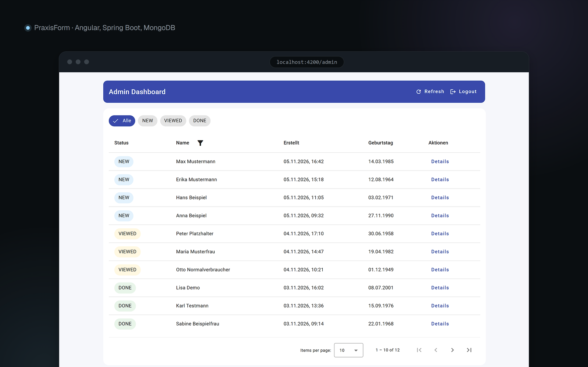
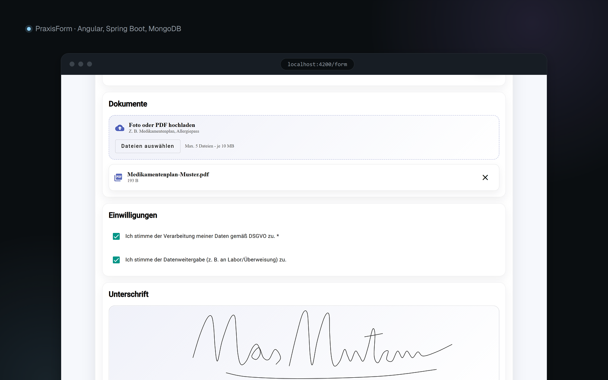
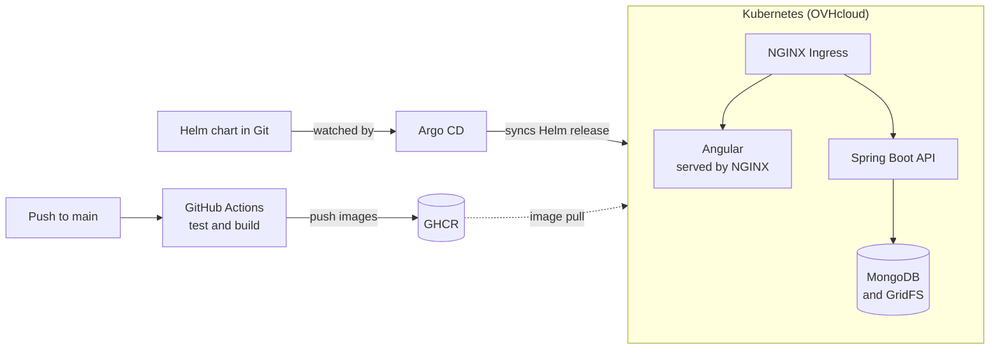

# PraxisForm

Digital patient intake for medical practices: patients fill in a form online, and practice staff review submissions in a live admin dashboard.

> **Team project** from the Infra X workshop (06/2026 – 09/2026). The live cluster was part of the workshop and isn't running anymore, so the app can be tried with the [local demo](#run-locally). It is a learning project and is not hardened for real patient data.

| Admin dashboard | Patient form |
| --- | --- |
|  |  |

## Features

- Patient intake form with symptoms, allergies, medications and pre-existing conditions
- File uploads (PDF, JPEG, PNG, WebP) stored in MongoDB GridFS
- Signature capture in the browser
- JWT-protected admin dashboard with filtering, editing and a status workflow
- Live updates for new submissions through Server-Sent Events
- Container builds, a Helm chart and an Argo CD application for Kubernetes delivery

## Architecture



## Tech Stack

| Area | Technologies |
| --- | --- |
| Backend | Java 17, Spring Boot 4, Spring Security, Spring Data MongoDB, JJWT, Maven |
| Frontend | Angular 21, TypeScript, Angular Material, RxJS |
| Data | MongoDB 7, GridFS |
| Delivery | Docker, Docker Compose, GitHub Actions, GHCR |
| Platform | Kubernetes (OVHcloud), Helm, Argo CD, Sealed Secrets, cert-manager, NGINX Ingress |

## Run Locally

The only requirement is Docker with Compose v2.

```bash
git clone https://github.com/Ziad-Alghawi/praxisform-kubernetes-platform.git
cd praxisform-kubernetes-platform
docker compose up
```

This starts MongoDB, the Spring Boot backend and the Angular frontend, and loads 12 fictional demo patients. The first start builds the images and takes a few minutes.

| What | Where |
| --- | --- |
| Patient form | http://localhost:4200/form |
| Admin login | http://localhost:4200/login |
| Backend health | http://localhost:8080/actuator/health |

**Demo login:** username `admin`, password `demo-only-not-a-real-password`. These credentials are fake and exist only for the local demo.

Useful commands:

```bash
docker compose up --build   # rebuild after changing code
docker compose down -v      # stop and delete all demo data
```

### Configuration

The demo works without any configuration. To change the values, copy `.env.example` to `.env`. The admin password is only applied when the database has no admin yet, so run `docker compose down -v` after changing it.

Outside the demo stack, the backend needs these environment variables:

| Variable | Purpose |
| --- | --- |
| `JWT_SECRET` | Required. JWT signing key, at least 32 characters |
| `ADMIN_DEFAULT_PASSWORD` | Password for the first admin. If unset, no admin is created |
| `MONGODB_URI` | Defaults to `mongodb://localhost:27017/praxis` |
| `JWT_EXP_MINUTES` | Token lifetime, defaults to `120` |

The demo data comes from [`scripts/seed/demo-seed.js`](scripts/seed/demo-seed.js). It runs once per database and only adds records.

## CI/CD and GitOps

**CI (GitHub Actions)** runs on every push and pull request to `main`:

1. Runs the backend tests with `mvn verify` against a MongoDB service container, and builds the frontend.
2. On `main`, builds both Docker images and pushes them to GHCR, tagged with the commit SHA and `latest`.

**CD (Argo CD)** handled delivery to the cluster:

1. `argocd/app.yaml` points Argo CD at `kubernetes-manifest/my-chart` on `main`.
2. Argo CD compares the chart with the cluster and syncs automatically, including pruning and self-healing.
3. The cluster pulls images from GHCR, using a registry secret stored as a Sealed Secret.
4. NGINX Ingress routes `/` to the frontend and `/api` to the backend, with TLS certificates from cert-manager.

The image versions are set in `values.yaml`, and CI does not update them, so a new release means changing that file in Git. The pipeline also has a manual `workflow_dispatch` deploy job that runs `helm upgrade --install`.

Application secrets are committed only as Sealed Secrets, which only the cluster can decrypt. MongoDB ran as a separate in-cluster service and is not part of this chart.

## Repository Structure

```text
praxis/                         Spring Boot backend
praxis-frontend/                Angular frontend
kubernetes-manifest/my-chart/   Helm chart
argocd/                         Argo CD application
.github/workflows/              GitHub Actions pipeline
scripts/seed/                   Fictional demo data
docs/screenshots/               README images
docker-compose.yml              Local demo stack
.env.example                    Optional local overrides with fake values
docker-compose.prod.yml         Earlier single-server setup, kept for reference
.gitlab-ci.yml                  Earlier GitLab pipeline, kept for reference
```
